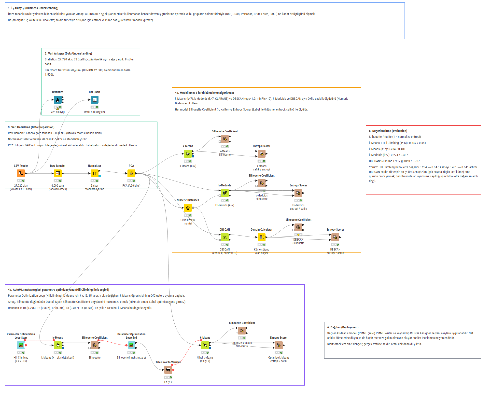

# Ağ Trafiği Kümeleme (CICIDS2017)

CICIDS2017 ağ akışlarını **etiket kullanmadan** benzer davranış gruplarına ayıran ve bu grupların saldırı türleriyle (DoS, DDoS, PortScan, Brute Force, Bot...) ne kadar örtüştüğünü ölçen bir kümeleme çalışması. Problem önce **KNIME** ile, sonra **Python** ile, her ikisinde de **CRISP-DM** adımlarıyla çözüldü. Etiketler modele girmez, yalnızca değerlendirmede kullanılır.



## Sonuçlar

### KNIME (6.000 akışlık tabakalı örnek, PCA %90)

| Model | Silhouette | Kalite (1 − normalize entropi) |
|---|---|---|
| **k-Means + Hill Climbing (k = 13)** | **0.347** | 0.541 |
| k-Means (k = 7) | 0.284 | 0.431 |
| k-Medoids (k = 7) | 0.274 | 0.487 |
| DBSCAN (63 küme + %17 gürültü) | - | **0.787** |

### Python (27.720 akış, log dönüşümü + PCA %95)

| Model | Küme | Silhouette | Davies-Bouldin | ARI | NMI |
|---|---|---|---|---|---|
| **AutoML (GA ile seçilen DBSCAN)** | 45 | **0.643** | **0.582** | **0.235** | **0.582** |
| DBSCAN | 70 | 0.517 | 0.740 | 0.136 | 0.500 |
| Agglomerative (Ward) | 7 | 0.361 | 1.281 | 0.148 | 0.287 |
| K-Means | 7 | 0.333 | 1.473 | 0.197 | 0.332 |
| MiniBatch K-Means | 7 | 0.315 | 1.476 | 0.204 | 0.348 |
| Gaussian Mixture | 7 | 0.287 | 1.830 | 0.198 | 0.358 |

AutoML modelinin ağırlıklı ortalama küme saflığı **0.887**. Bazı kümeler neredeyse tamamen tek bir saldırı türünden oluşuyor (ör. 773 PortScan + 3 BENIGN).

## AutoML

| | KNIME | Python |
|---|---|---|
| Metasezgisel parametre optimizasyonu | Parameter Optimization Loop, **Hill Climbing** ile k seçimi, Silhouette maksimizasyonu | Optuna **NSGA-II** (genetik algoritma), 60 deneme, Silhouette maksimizasyonu (en az 3 küme, en fazla %20 gürültü kısıtı) |
| En uygun algoritma seçimi | 3 algoritmanın (k-Means, k-Medoids, DBSCAN) Silhouette + entropi ile karşılaştırılması | GA arama uzayında algoritma da bir gen: K-Means, Gaussian Mixture, DBSCAN + PCA boyutu |

Her iki tarafta da amaç fonksiyonu etiketsiz (Silhouette); gerçek etiketler yalnızca sonuçta raporlanır.

## Klasör yapısı

```
knime/       KNIME_Kumeleme_CICIDS2017.knwf, iş akışı görseli (png/svg)
notebooks/   01_network_traffic_clustering.ipynb (çalıştırılmış, çıktılarıyla)
docs/        KNIME_Raporu.md, Python_Raporu.md, figures/
data/        27.720 akışlık örneklem ve kaynak bilgisi
```

## Çalıştırma

**KNIME:** KNIME Analytics Platform 5.x → File → Import KNIME Workflow → `knime/KNIME_Kumeleme_CICIDS2017.knwf`. Veri iş akışının içinde, ek eklenti gerekmez.

**Python:**
```bash
pip install -r requirements.txt
jupyter notebook notebooks/01_network_traffic_clustering.ipynb
```

## Raporlar

- [KNIME raporu](docs/KNIME_Raporu.md)
- [Python raporu](docs/Python_Raporu.md)

Veri: [CICIDS2017, Canadian Institute for Cybersecurity](https://www.unb.ca/cic/datasets/ids-2017.html)
