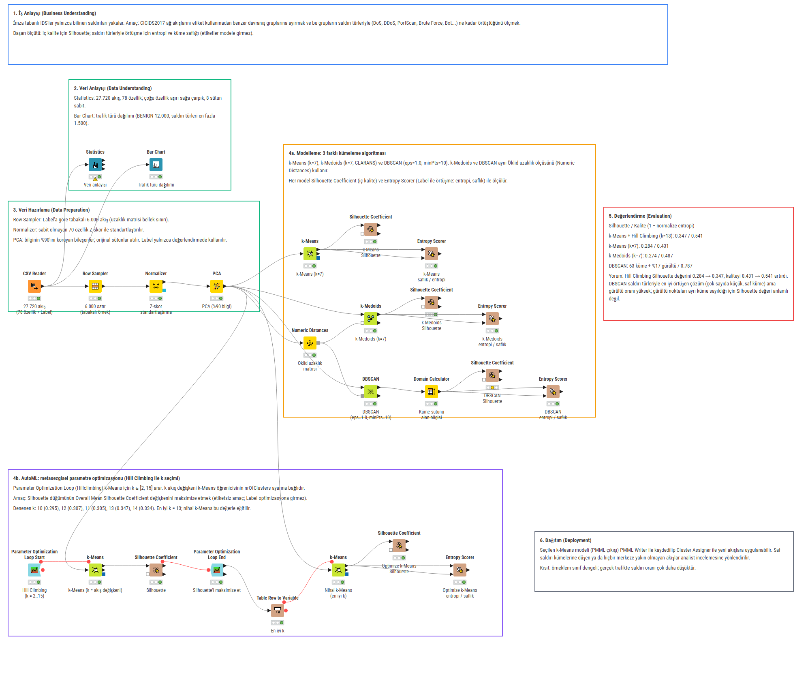

# KNIME Raporu: Ağ Trafiği Kümeleme (CICIDS2017)

İş akışı: `knime/KNIME_Kumeleme_CICIDS2017.knwf` (KNIME Analytics Platform 5.x)



İş akışı CRISP-DM aşamalarına göre renkli kutulara ayrılmıştır. Her kutunun içinde o aşamanın açıklaması yazılıdır.

## 1. İş Anlayışı

İmza tabanlı IDS'ler yalnızca bilinen saldırıları yakalar. Amaç, ağ akışlarını etiket kullanmadan benzer davranış gruplarına ayırmak ve bu grupların saldırı türleriyle ne kadar örtüştüğünü ölçmek.

- İç kalite: **Silhouette**.
- Saldırı türleriyle örtüşme: **Entropy Scorer** (entropi ve kalite = 1 − normalize entropi).

`Label` sütunu hiçbir modele girmez, yalnızca değerlendirmede kullanılır.

## 2. Veri Anlayışı

| Düğüm | Görev |
|---|---|
| CSV Reader | 27.720 akış, 78 özellik + Label |
| Statistics | Özelliklerin çoğu aşırı sağa çarpık; 8 sütun sabit (varyans 0) |
| Bar Chart | Trafik türü dağılımı: BENIGN 12.000, saldırı türleri en fazla 1.500 |

## 3. Veri Hazırlama

| Düğüm | Görev |
|---|---|
| Row Sampler | Label'a göre tabakalı 6.000 akış. Uzaklık matrisi tabanlı yöntemler (k-Medoids, DBSCAN) için bellek sınırı |
| Normalizer | Sabit olmayan 70 özellik Z-skor ile standartlaştırılır |
| PCA | Bilginin %90'ını koruyan bileşenler (18 boyut), orijinal sütunlar atılır |

## 4a. Modelleme: 3 algoritma

| Model | Düğümler | Ayarlar |
|---|---|---|
| k-Means | k-Means | k = 7, sabit tohum |
| k-Medoids | Numeric Distances → k-Medoids | k = 7, CLARANS, Öklid uzaklığı |
| DBSCAN | Numeric Distances → DBSCAN → Domain Calculator | eps = 1.0, minPts = 10 |

Her modelin çıktısı iki değerlendirme düğümüne gider:
- **Silhouette Coefficient**: küme sütunu = Cluster, Label hariç tüm boyutlar.
- **Entropy Scorer**: referans = Label, kümeleme = Cluster.

## 4b. AutoML: metasezgisel parametre optimizasyonu (Hill Climbing ile k seçimi)

```
Parameter Optimization Loop Start (Hillclimbing, k = 2..15)
  → k-Means (nrOfClusters = k) → Silhouette Coefficient
→ Parameter Optimization Loop End (Overall Mean Silhouette Coefficient'i maksimize et)
→ Table Row to Variable → Nihai k-Means (en iyi k) → Silhouette + Entropy Scorer
```

- Amaç fonksiyonu etiketsiz: Silhouette. Label optimizasyona girmez.
- Hill Climbing'in denediği k değerleri ve Silhouette:

| k | Silhouette |
|---|---|
| 10 | 0.295 |
| 11 | 0.305 |
| 12 | 0.307 |
| **13** | **0.347** |
| 14 | 0.334 |

k = 13'ten sonra Silhouette düştüğü için arama durdu.

## 5. Değerlendirme (6.000 akış)

| Model | Silhouette | Normalize entropi | Kalite |
|---|---|---|---|
| **k-Means + Hill Climbing (k = 13)** | **0.347** | 0.459 | 0.541 |
| k-Means (k = 7) | 0.284 | 0.569 | 0.431 |
| k-Medoids (k = 7) | 0.274 | 0.513 | 0.487 |
| DBSCAN (63 küme + %17 gürültü) | - | 0.213 | **0.787** |

- Hill Climbing, k-Means'in Silhouette değerini 0.284'ten 0.347'ye, saldırı türleriyle örtüşmesini (kalite) 0.431'den 0.541'e çıkardı.
- DBSCAN saldırı türleriyle en iyi örtüşen çözüm: çok sayıda küçük ve saf küme üretiyor. Ama akışların %17'sini (1.039) gürültü sayıyor. Gürültü noktaları ayrı bir küme olarak ele alındığı için KNIME'ın Silhouette düğümü DBSCAN için anlamlı bir değer üretmedi.
- Python tarafında GA ile seçilen DBSCAN (5 PCA bileşeni) Silhouette 0.643, saflık 0.887 verdi: iki araç da yoğunluk tabanlı yöntemin saldırı paternlerini en iyi ayırdığını gösteriyor.

## 6. Dağıtım

k-Means'in PMML çıkışı PMML Writer ile kaydedilip Cluster Assigner ile yeni akışlara uygulanabilir. Saf saldırı kümelerine düşen ya da hiçbir merkeze yakın olmayan akışlar analiste yönlendirilir. Kısıt: örneklem sınıf dengeli; gerçek trafikte saldırı oranı çok daha düşüktür.
