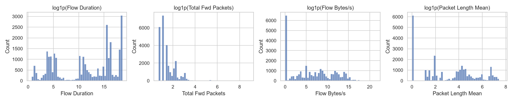
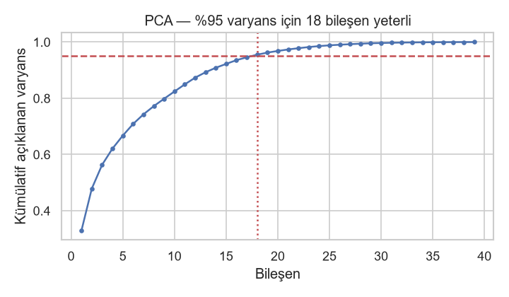
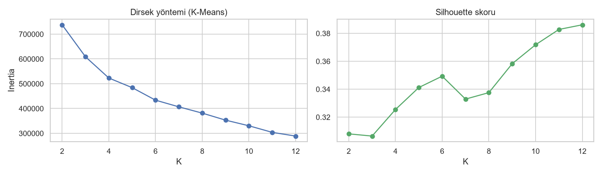
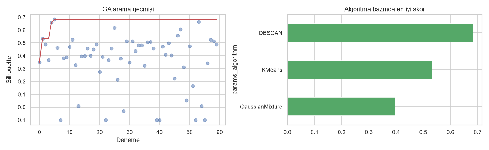
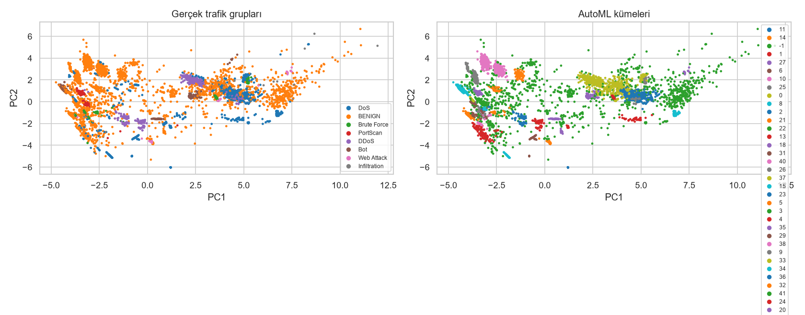

# Python Raporu: Ağ Trafiği Kümeleme (CICIDS2017)

Notebook: [`notebooks/01_network_traffic_clustering.ipynb`](../notebooks/01_network_traffic_clustering.ipynb) (çalıştırılmış, tüm çıktılarıyla)

Kütüphaneler: pandas, scikit-learn, Optuna, matplotlib, seaborn.

## 1. İş Anlayışı

İmza tabanlı saldırı tespit sistemleri yalnızca bilinen saldırıları yakalar. Kümeleme, etiket kullanmadan benzer ağ davranışlarını gruplayarak bilinmeyen paternleri de ortaya çıkarabilir.

- İç kalite: **Silhouette** (yüksek iyi) ve **Davies-Bouldin** (düşük iyi).
- Saldırı türleriyle örtüşme: **ARI**, **NMI** ve **küme saflığı**. Etiketler yalnızca değerlendirmede kullanılır, modele girmez.

## 2. Veri Anlayışı

- CICIDS2017'nin 8 günlük CSV'lerinden sınıf başına sınırlı örnek: BENIGN 12.000, her saldırı türü en fazla 1.500. Toplam **27.720 akış, 78 özellik**.
- 15 trafik türü: BENIGN, DDoS, DoS (Hulk, GoldenEye, slowloris, Slowhttptest), PortScan, Bot, FTP/SSH-Patator, Web Attack (Brute Force, XSS, SQL Injection), Infiltration, Heartbleed.
- Özelliklerin çoğu aşırı sağa çarpık: çok sayıda kısa akış, az sayıda çok uzun akış. Örneğin Flow Duration medyanı 179 bin µs, ortalaması 17.7 milyon µs.

## 3. Veri Hazırlama

1. Varyansı 0 olan 8 sütun çıkarıldı → 70 özellik.
2. `log1p` dönüşümü ile çarpıklık azaltıldı (negatif değerler 0'a kırpıldı).
3. Birbiriyle |r| > 0.95 korelasyonlu 31 sütun çıkarıldı → **39 özellik**.
4. StandardScaler ile standartlaştırma.
5. PCA: %95 varyansı koruyan bileşen sayısı seçildi.

## 4. Modelleme

### 4.1 Algoritma karşılaştırması (PCA %95 uzayında)

| Model | Küme | Gürültü % | Silhouette | Davies-Bouldin | ARI | NMI |
|---|---|---|---|---|---|---|
| K-Means (k=7) | 7 | 0 | 0.333 | 1.473 | 0.197 | 0.332 |
| MiniBatch K-Means | 7 | 0 | 0.315 | 1.476 | 0.204 | 0.348 |
| Gaussian Mixture | 7 | 0 | 0.287 | 1.830 | 0.198 | 0.358 |
| Agglomerative (Ward) | 7 | 0 | 0.361 | 1.281 | 0.148 | 0.287 |
| DBSCAN | 70 | 4.8 | 0.517 | 0.740 | 0.136 | 0.500 |

k = 7 değeri dirsek yöntemi ve Silhouette eğrisinden seçildi.

### 4.2 AutoML: genetik algoritma (NSGA-II) ile algoritma + hiperparametre + boyut seçimi

- Etiketsiz bir problemde AutoML'in amaç fonksiyonu da etiketsiz olmalı. Bu yüzden **Silhouette maksimize edilir**.
- Kısıtlar: en az 3 küme ve en fazla %20 gürültü. Aksi halde ceza (-1). Böylece GA tek kümeye çökmez.
- Arama uzayı: algoritma (K-Means / Gaussian Mixture / DBSCAN), PCA bileşen sayısı (3 ile %95 boyutu arası), algoritmaya özel parametreler (k, kovaryans tipi, eps, min_samples).
- Optuna `NSGAIISampler` (popülasyon 12, mutasyon 0.25), 60 deneme.
- Sonuç: **DBSCAN**, 5 PCA bileşeni, eps = 0.54, min_samples = 58. Silhouette 0.683 (değerlendirme örnekleminde).

## 5. Değerlendirme

| Model | Küme | Gürültü % | Silhouette | Davies-Bouldin | ARI | NMI |
|---|---|---|---|---|---|---|
| **AutoML (DBSCAN)** | 45 | 13.5 | **0.643** | **0.582** | **0.235** | **0.582** |

- AutoML çözümü tüm metriklerde temel modelleri geçti.
- Ağırlıklı ortalama **küme saflığı 0.887**: bir kümedeki akışların ortalama %89'u aynı trafik türünden.
- Bazı kümeler neredeyse tamamen tek bir saldırı türünden oluşuyor: ör. bir küme 773 PortScan + 3 BENIGN, bir diğeri 753 Brute Force + 0 BENIGN. Etiket kullanılmadan saldırı paternleri ayrışabiliyor.
- BENIGN trafik birden çok kümeye dağılıyor: normal trafik heterojen.

## 6. Dağıtım ve sonuç

- SOC'ta "davranış profili" olarak kullanılabilir: yeni akış en yakın kümeye atanır; hiçbir kümeye uymayan (gürültü) ya da saf saldırı kümelerine düşen akışlar analiste yönlendirilir.
- Silhouette ile ARI arasında gerilim var: iç tutarlılığı en yüksek çözüm, saldırıları en iyi ayıran çözümle her zaman aynı değil. Bu yüzden AutoML amacı (etiketsiz) ve iş amacı (saldırı keşfi) ayrı raporlandı.
- Kısıtlar: örneklem sınıf dengeli; gerçek trafikte saldırı oranı çok daha düşüktür. Infiltration, Heartbleed ve SQL Injection çok az örnek içerir.
